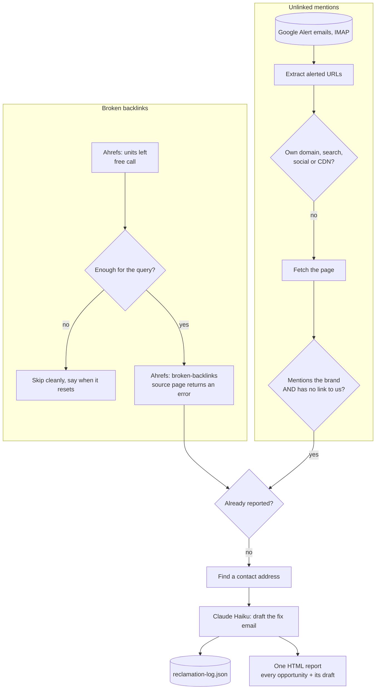

# Link Reclamation: find the links you already earned and lost, and the mentions that never linked

A weekly job with two detectors. One asks Ahrefs for backlinks whose source page is now broken. The other reads Google Alert emails for pages that name the brand, then visits each page to see whether it actually links. For every confirmed case it finds a contact, drafts the email asking for the fix, and puts everything in one report.

## The problem

Most link building is asking strangers for something new. Reclamation is different: the site has already chosen to link to you or write about you. The link broke when a page moved, or the author named the brand and forgot the hyperlink. These are the easiest requests to get a yes on, and almost nobody makes them, because finding the cases means checking hundreds of pages by hand.

Two details make a naive version unreliable:

- **An alert is not a missing link.** Google Alerts fire on any mention, including pages that already link. Emailing those site owners to ask for a link they already gave is embarrassing.
- **The data source is metered.** The broken-backlink query costs API units, and a job that fails loudly every time the monthly allowance runs out trains you to ignore its failures.

## What it does

`src/link-reclamation.js` runs weekly:

| Detector | Source | What it does |
|---|---|---|
| Broken backlinks | Ahrefs broken-backlinks report | Lists links to the site where the linking page returns an error status, with the source URL, its authority, the target URL, the HTTP code and whether the link is dofollow |
| Unlinked mentions | Google Alert emails in the mailbox | Extracts the alerted URLs, drops our own domains, search engines, social platforms and CDNs, fetches each page, and keeps only pages that mention a brand term and contain no link to our domain |

For each result it looks for a contact address on the site, drafts a short email with Claude, records the item so it is not raised again, and sends one HTML report with every opportunity and its ready-to-send draft.

`--broken-only` and `--mentions-only` run a single detector. `--dry-run` prints the report without emailing or logging.

## Architecture



## Key design decisions

**A mention is verified before anyone is emailed.** The job fetches the alerted page and checks two things separately: does the text contain a brand term, and does the HTML contain an anchor pointing at our domain. Only "mentioned, not linked" qualifies. The domain appearing as plain text does not count as a link. `npm test` covers these cases offline.

**Running out of quota is not an error.** Before the metered query, a free call reads how many units are left. If there are too few, the detector is skipped with a message saying when the allowance resets, and the mentions detector still runs. A quota error from the query itself is handled the same way.

**The two detectors are independent.** Either can fail or be skipped without affecting the other, and each has its own flag for running alone.

**Drafts, not sends.** The job writes the email and hands it to a person in the report. A reclamation request goes to someone who already did you a favor, so a human reads it before it leaves.

**Nothing is raised twice.** Every broken link and every mention is recorded in a log keyed by its URL, and items already in the log are left out of later reports.

**The brand is config.** The domain, the brand terms to look for, the pages a draft may suggest and the content rules come from `config/brand.json`.

## Repository layout

```
src/link-reclamation.js    both detectors, page verification, contact finding, drafts, report
src/config.js              env + config/brand.json loader
config/brand.example.json  domain, brand terms, pages to suggest, content rules
scripts/test-classify.js   offline tests for the linked / mentioned classification
.github/workflows/         weekly run, state carried in the Actions cache
```

## Setup

Requires Node 20+, an Ahrefs API v3 token, an Anthropic API key, and a Gmail mailbox with an app password that receives Google Alerts for your brand terms.

```bash
npm install
npm test                                        # offline, no keys needed
cp .env.example .env                            # fill in values
cp config/brand.example.json config/brand.json  # your domain, terms and pages
npm run dry-run                                 # prints the report, sends nothing
npm run reclaim
```

| Variable | Purpose |
|---|---|
| `AHREFS_API_TOKEN` | Broken-backlink data and the quota check |
| `ANTHROPIC_API_KEY`, `CLAUDE_MODEL` | Drafting the emails |
| `GMAIL_USER`, `GMAIL_APP_PASSWORD` | Reading Google Alerts and sending the report |
| `SENDER_NAME`, `CONFIG_DIR`, `STATE_DIR` | Optional overrides |

Scheduled runs are off by default. Set the repository variable `ENABLE_SCHEDULE` to `true` to turn the schedule on; manual runs from the Actions tab always work.

---

Extracted from a production automation suite I built and ran for a live e-commerce and B2B wholesale business, 2026.

© Michael Wootan. Source shared for portfolio review; all rights reserved.
